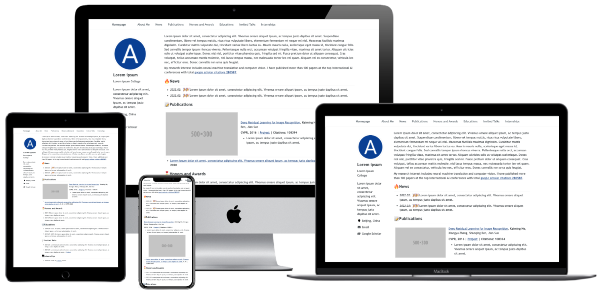

<h1 align="center">
AcadHomepage
</h1>

<div align="center">

[](https://github.com/RayeRen/acad-homepage.github.io)
[](https://github.com/RayeRen/acad-homepage.github.io)
[](https://github.com/RayeRen/acad-homepage.github.io)
[](https://github.com/RayeRen/acad-homepage.github.io/blob/main/LICENSE)  | [中文文档](./docs/README-zh.md) 
</div>

<p align="center">A Modern and Responsive Academic Personal Homepage</p>

<p align="center">
    <br>
    
    <br>
</p>

Some examples:
- [Demo Page](https://rayeren.github.io/acad-homepage.github.io/)
- [Personal Homepage of the author](https://rayeren.github.io/)

## 本站论文维护

只维护 `_bibliography/papers.bib`。首页从中筛选 `selected = {true}` 的论文，Publications 页面展示全部论文；不再维护 `selected.bib`。

直接粘贴 DBLP / 出版社的 BibTeX 条目，然后在同一条目内添加网页字段即可。下面是格式示例，不是真实文献：

```bibtex
@article{example2026,
  author = {Yi Bian and
            Fangyu Zheng},
  title = {{EXAMPLE}: Paper title},
  journal = {Journal name},
  year = {2026},
  selected = {true},
  abbr = {TC},
  corresponding_author = {Fangyu Zheng},
  preview = {assets/img/papers/example.svg}
}
```

- `author` 使用 `Yi Bian and Fangyu Zheng` 格式，换行不影响解析。不要在姓名中添加星号、HTML 或 LaTeX 标记。
- `_config.yml` 中的 `publication_author: "Yi Bian"` 只需配置一次，所有列表自动为该姓名加粗、加下划线。
- `corresponding_author` 填真实通讯作者；多名写为 `{Yi Bian and Fangyu Zheng}`。省略即不标记，不根据作者顺序推断。若姓名不属于作者列表，构建会报出论文键和不匹配的姓名。
- `selected = {true}` 显示在首页；省略或设为 `{false}` 则只显示在完整列表。
- `preview` 可选，填写图片路径；没有图片则显示文字。图片存放在 `assets/img/papers/`。
- `url` 是标准网页链接字段；只填写 `doi` 时，首页标题也会自动链接到 DOI。
- `abbr`、`category` 是可选展示字段。已有缩写的 CCF/JCR 标签继续读取 `_data/venues.yml`；只有新增未配置的期刊/会议分类时才需维护该文件。
- `abstract` 可选，首页和完整列表共用同一份摘要。
- Bib 按钮默认显示，可用 `bibtex_show = {false}` 隐藏。复制出的 BibTeX 自动去掉 `selected`、`preview`、`corresponding_author` 等网页字段，保留大小写保护花括号、DOI、URL 和 DBLP 元数据。不要从 DBLP 示例复制已经损坏的标题转义。
- 引用键可以保留 DBLP 的 `DBLP:journals/...` 格式，但每条必须唯一；年份分组读取 `year` 字段。

当前通讯作者沿用迁移前的数据，需由作者依据论文正式署名核对。

本地验证和预览：

```bash
docker compose run --rm website bundle exec ruby test/publications_test.rb
docker compose run --rm website bundle exec jekyll build --trace
docker compose up -d
```

访问 http://localhost:4002/ 和 http://localhost:4002/publications/ 。服务使用 `--no-watch`，修改后执行 `docker compose restart website` 重新生成页面。部署仍使用仓库已有的 GitHub Actions（自定义 `_plugins` 不适用于 GitHub Pages 的受限内置构建）。

## Key Features
- **Automatically update google scholar citations**: using the google scholar crawler and github action, this REPO can update the author citations and publication citations automatically.
- **Support Google analytics**: you can trace the traffics of your homepage by easy configuration.
- **Responsive**: this homepage automatically adjust for different screen sizes and viewports.
- **Beautiful and Simple Design**: this homepage is beautiful and simple, which is very suitable for academic personal homepage.
- **SEO**: search Engine Optimization (SEO) helps search engines find the information you publish on your homepage easily, then rank it against similar websites.

## Quick Start

1. Fork this REPO and rename to `USERNAME.github.io`, where `USERNAME` is your github USERNAME.
1. Configure the google scholar citation crawler:
    1. Find your google scholar ID in the url of your google scholar page (e.g., https://scholar.google.com/citations?user=SCHOLAR_ID), where `SCHOLAR_ID` is your google scholar ID.
    1. Set GOOGLE_SCHOLAR_ID variable to your google scholar ID in `Settings -> Secrets -> Actions -> New repository secret` of the REPO website with `name=GOOGLE_SCHOLAR_ID` and `value=SCHOLAR_ID`.
    1. Click the `Action` of the REPO website and enable the workflows by clicking *"I understand my workflows, go ahead and enable them"*. This github action will generate google scholar citation stats data `gs_data.json` in `google-scholar-stats` branch of your REPO. When you update your main branch, this action will be triggered. This action will also be trigger 08:00 UTC everyday.
1. Generate favicon using [favicon-generator](https://redketchup.io/favicon-generator) and download all generated files to `REPO/images`.
1. Modify the configuration of your homepage `_config.yml`:
    1. `title`: the title of your homepage
    1. `description`: the description of your homepage
    1. `repository`: USER_NAME/REPO_NAME  
    1. `google_analytics_id` (optional): google analytics ID
    1. SEO Related keys (optional): get these keys from search engine consoles (e.g. Google, Bing and Baidu) and paste here.
    1. `author`: the author information of this homepage, including some other websites, emails, city and univeristy.
    1. More configuration details are described in the comments.
1. Add your homepage content in `_pages/about.md`.
    1. You can use html+markdown syntax just same as jekyll.
    1. You can use a `<span>` tag with class `show_paper_citations` and attribute `data` to display the citations of your paper. Set the data to the google scholar paper ID. For
        ```html
        <span class='show_paper_citations' data='DhtAFkwAAAAJ:ALROH1vI_8AC'></span>
        ``` 
        > Q: How to get the google scholar paper ID?   
        > A: Enter your google scholar homepage and click the paper name. Then you can see the paper ID from `citation_for_view=XXXX`, where `XXXX` is the required paper ID.
1. Your page will be published at `https://USERNAME.github.io`.

## Debug Locally

1. Clone your REPO to local using `git clone`.
1. Install Jekyll building environment, including `Ruby`, `RubyGems`, `GCC` and `Make` following [the installation guide](https://jekyllrb.com/docs/installation/#requirements).
1. Run `bash run_server.sh` to start Jekyll livereload server.
1. Open http://127.0.0.1:4000 in your browser.
1. If you change the source code of the website, the livereload server will automatically refresh.
1. When you finish the modification of your homepage, `commit` your changings and `push` to your remote REPO using `git` command.

# Acknowledges

- AcadHomepage incorporates Font Awesome, which is distributed under the terms of the SIL OFL 1.1 and MIT License.
- AcadHomepage is influenced by the github repo [mmistakes/minimal-mistakes](https://github.com/mmistakes/minimal-mistakes), which is distributed under the MIT License.
- AcadHomepage is influenced by the github repo [academicpages/academicpages.github.io](https://github.com/academicpages/academicpages.github.io), which is distributed under the MIT License.
